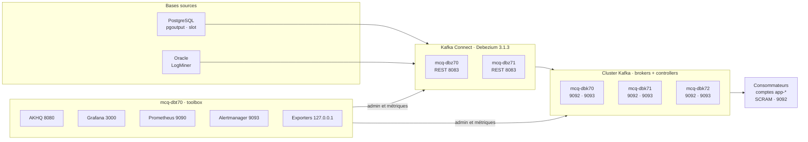

# Architecture de la plateforme CDC

*Mis à jour le 4 novembre 2026*

Debezium lit en continu les modifications des bases PostgreSQL et Oracle, puis les publie dans un cluster Kafka de 3 nœuds. Les applications consommatrices lisent ces modifications depuis Kafka. Une toolbox porte l'administration (AKHQ, commandes Kafka) et la supervision.

## Schéma

Le flux va de gauche à droite : bases, workers Debezium, cluster Kafka, consommateurs. La toolbox administre Connect et Kafka, et collecte les métriques de toutes les machines. node_exporter (port 9100) tourne sur les 6 machines. Les interfaces web sont ouvertes à tous les réseaux, avec authentification.

## Machines et rôles

| Machine | Rôle | Services | Ports écoutés | Dimensionnement proposé |
| --- | --- | --- | --- | --- |
| mcq-dbk70 / 71 / 72 | Broker + controller KRaft (node.id 1 / 2 / 3) | `kafka`, `node_exporter` | 9092 clients, 9093 quorum, 7071 métriques JMX, 9100 | 4 à 8 vCPU, 16 à 32 Go, heap 6 Go, FS données 70 Go (extensible) |
| mcq-dbz70 / 71 | Workers Kafka Connect + Debezium | `kafka-connect`, `node_exporter` | 8083 API REST, 7072 métriques JMX, 9100 | 4 vCPU, 16 Go, heap 8 Go |
| mcq-dbt70 | Toolbox : administration et supervision | `akhq`, `prometheus`, `alertmanager`, `grafana-server`, `kafka_exporter`, `blackbox_exporter`, `node_exporter` | 8080 AKHQ, 28081 métriques AKHQ, 9090 Prometheus, 9093 Alertmanager, 3000 Grafana, 9100 ; 9308 et 9115 sur 127.0.0.1 | 4 vCPU, 8 Go, FS données 30 Go |

Toutes les machines sont en RHEL 8.10 x86_64, avec SELinux en `enforcing`, sans pare-feu local, dans le domaine `cgi.credit-cgi.fr`.

## Versions

| Composant | Version | Runtime |
| --- | --- | --- |
| Apache Kafka (brokers, Connect, commandes) | 3.9.1, Scala 2.13 | OpenJDK 21.0.12.1 (RPM) |
| Debezium PostgreSQL / Oracle | 3.1.3.Final | dans Kafka Connect |
| Pilotes Oracle (ojdbc11, xdb, xmlparserv2) | 21.15.0.0 | dans le plugin Oracle |
| AKHQ | 0.28.0 (jar) | Temurin JRE 25.0.4.1+1, dédié |
| Prometheus | 3.13.2 | binaire Go |
| Alertmanager | 0.34.0 | binaire Go |
| Grafana | 13.2.0 (RPM) | binaire Go |
| node_exporter / kafka_exporter / blackbox_exporter | 1.12.1 / 1.9.0 / 0.28.0 | binaires Go |
| Agent JMX exporter | 1.6.0 | agent Java |

## Flux réseau

| Source | Destination | Port | Protocole et authentification |
| --- | --- | --- | --- |
| Workers Connect | Bases PostgreSQL | 5432 (à confirmer) | réplication logique, compte Debezium fourni par les DBA |
| Workers Connect | Bases Oracle | 1521 (à confirmer) | JDBC LogMiner, compte Debezium fourni par les DBA |
| Workers Connect, AKHQ, kafka_exporter, consommateurs | Brokers | 9092 | SASL_PLAINTEXT, SCRAM-SHA-512 |
| Brokers entre eux | Brokers | 9092 | SASL_PLAINTEXT, SCRAM-SHA-512 (compte `admin`) |
| Brokers entre eux | Controllers | 9093 | SASL_PLAINTEXT, PLAIN (compte `admin`) |
| AKHQ, administrateurs | API REST Connect | 8083 | HTTP, authentification Basic |
| Worker Connect | Worker leader | 8083 | HTTP, requêtes internes signées par Connect |
| Prometheus | Toutes les machines | 9100, 7071, 7072 | HTTP, sans authentification (métriques seules) |
| Postes d'administration | Toolbox | 8080, 3000, 9090, 9093 | HTTP, authentification par service |

## Sécurité Kafka

- Toute connexion à Kafka est authentifiée. Un client sans identifiants est rejeté.
- Autorisations : `StandardAuthorizer` de KRaft, avec `allow.everyone.if.no.acl.found=false`. Ce qu'aucune ACL ne permet explicitement est refusé.
- Les mots de passe circulent en clair sur le réseau, faute de TLS. Le passage en SASL_SSL est prévu dans les améliorations.

| Compte | Type | Utilisé par | Droits |
| --- | --- | --- | --- |
| `admin` | SCRAM + PLAIN | brokers, administrateurs | super-utilisateur |
| `connect` | SCRAM | workers Connect, Debezium | lecture et écriture sur `connect-cdc-*`, `cdc.*`, `__debezium-heartbeat*` ; groupes `connect-cdc*` et `cdc.*` |
| `akhq` | SCRAM | AKHQ | lecture complète + administration des topics et groupes. **Interdit** : supprimer ou modifier `connect-cdc-*` et `cdc.schemahistory.*`, écrire dans `cdc.*` |
| `kexporter` | SCRAM | kafka_exporter | description des topics et des groupes |
| `app-<nom>` | SCRAM | consommateurs applicatifs | lecture de leurs topics et groupes (créés à l'étape 6) |
| `connect-admin` | Basic REST | administrateurs, scripts | API REST Connect complète |
| `akhq-connect` | Basic REST | AKHQ | API REST Connect complète, restreinte par les rôles AKHQ |

L'API REST de Connect authentifie les comptes, mais ne gère pas de rôles. La séparation lecture / écriture des exploitants passe donc par les profils `admin` et `lecteur` d'AKHQ.

## Conventions de nommage et topics

| Élément | Nom |
| --- | --- |
| Topics de données | `cdc.<techno>.<source>.<schéma>.<table>`, ex. `cdc.ora.FACT.SCH1.CLIENT`, `cdc.pg.<base>.<schéma>.<table>` |
| Historique de schéma Oracle | `cdc.schemahistory.<connecteur>` |
| Heartbeat Debezium | `__debezium-heartbeat.cdc.*` |
| Cluster Connect | groupe `connect-cdc` |
| Topics internes Connect | `connect-cdc-configs` (1 partition), `connect-cdc-offsets` (25), `connect-cdc-status` (5), tous compactés, réplication 3 |

Valeurs par défaut du cluster :
- réplication 3 et `min.insync.replicas=2` ;
- 3 partitions par topic ;
- rétention 7 jours, segments de 512 Mo ;
- création automatique de topics désactivée.

Le cluster tolère la perte d'un nœud sans interruption ni perte de données.

Le topic `connect-cdc-offsets` contient la position de lecture de chaque connecteur (LSN pour PostgreSQL, SCN pour Oracle). Le supprimer obligerait à refaire un snapshot complet des tables.

## Arborescence

| Chemin | Contenu | Machines |
| --- | --- | --- |
| `/opt/bundle/artifacts` | bundle d'installation hors ligne | toutes |
| `/opt/kafka/kafka_2.13-3.9.1`, lien `/opt/kafka/current` | binaires Kafka (root, lecture seule) | dbk, dbz, dbt |
| `/etc/kafka` | `server.properties` ou `connect-distributed.properties`, fichiers log4j, JAAS REST | dbk, dbz |
| `/var/log/kafka` | `server.log`, `controller.log`, `connect.log` | dbk, dbz |
| `/inte/vq/DAT/data/KFK/data` | données Kafka et métadonnées KRaft | dbk |
| `/opt/kafka/plugins` | plugins Debezium et pilotes Oracle | dbz |
| `/opt/jmx_exporter`, `/etc/jmx_exporter` | agent JMX et règles | dbk, dbz |
| `/opt/java/temurin-25` | Java 25 dédié à AKHQ | dbt |
| `/opt/akhq`, `/etc/akhq/application.yml` | AKHQ et sa configuration | dbt |
| `/etc/prometheus`, `/etc/alertmanager`, `/etc/blackbox_exporter` | configurations, règles, secrets | dbt |
| `/etc/grafana`, `/etc/sysconfig/grafana-server` | configuration et provisioning de Grafana | dbt |
| `/inte/vq/DAT/data/AKH/{prometheus,alertmanager,grafana}` | données de supervision | dbt |
| `/usr/local/bin` | binaires Prometheus, Alertmanager et exporters | toutes |
| `/root/kafka-admin.properties` | identifiants admin Kafka pour les commandes | dbt |

## SELinux

SELinux reste en `enforcing`. Les services lancés par systemd tournent dans le domaine `unconfined_service_t` : il suffit donc d'étiqueter correctement les fichiers.

| Règle `semanage fcontext` | Type | Raison |
| --- | --- | --- |
| `/inte/vq/DAT/data/KFK(/.*)?` | `var_lib_t` | chemin non standard des données Kafka |
| `/inte/vq/DAT/data/AKH(/.*)?` | `var_lib_t` | chemin non standard des données de supervision |
| `/opt/kafka/kafka_2.13-3.9.1/bin(/.*)?` | `bin_t` | scripts Kafka exécutés par systemd |
| `/opt/java/jdk-25.0.4.1\+1-jre/bin(/.*)?` | `bin_t` | Java d'AKHQ |

Règle d'exploitation : toujours copier (`cp`) ou extraire directement les fichiers, puis lancer `restorecon`. Ne jamais déplacer avec `mv` depuis `/tmp` ou `/home`. Pour vérifier qu'il n'y a pas de refus : `ausearch -m avc -ts today | grep denied`.

## Supervision

- **Métriques collectées** : 27 cibles, toutes les 30 s.
  - système et services systemd des 6 machines ;
  - JMX des brokers et des workers, dont les métriques Debezium ;
  - lag des consommateurs et nombre de brokers (kafka_exporter) ;
  - métriques d'AKHQ, de Grafana, de Prometheus et d'Alertmanager.
- **Sondes** (blackbox_exporter) :
  - ports 9092 et 9093 des brokers, en TCP ;
  - API REST Connect, Prometheus et Alertmanager : réponse 401 attendue ;
  - AKHQ et Grafana : réponse 200 attendue.
- **Rétention** Prometheus : 30 jours, plafond de 20 Go.
- **16 règles d'alerte** :
  - disponibilité : cible injoignable, service systemd en échec, sonde en échec ;
  - disques : FS Kafka à 80 % et 90 %, autres FS à 90 % ;
  - Kafka : partitions sous-répliquées, sous `min.insync.replicas` ou hors ligne, nombre de controllers actifs différent de 1, moins de 3 brokers ;
  - Connect et Debezium : connecteur ou tâche en échec, Debezium déconnecté, Debezium en retard de plus de 5 min ;
  - consommateurs : retard de plus de 100 000 messages.
- **Alertmanager** affiche les alertes sans les envoyer : aucun destinataire n'est encore configuré.
